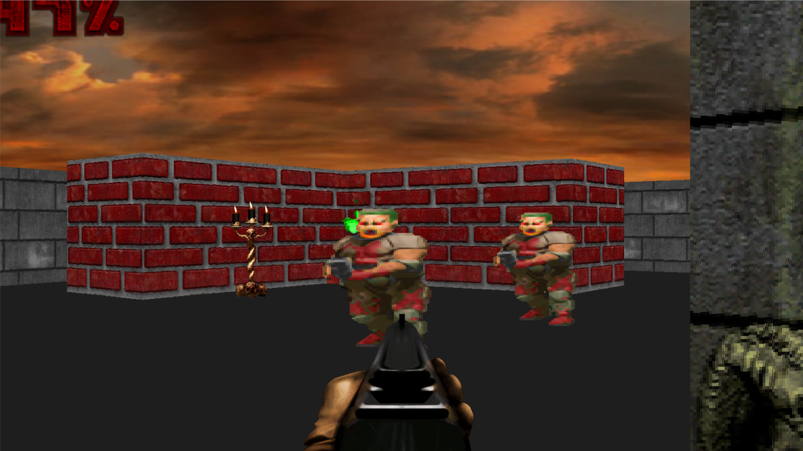
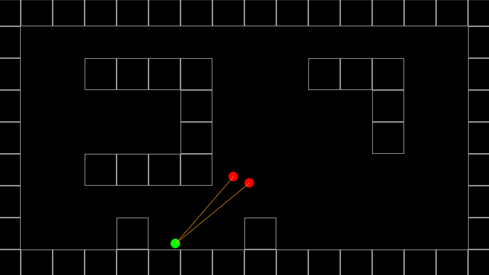

# Python_Doom3D (Raycasting FPS)

[English](#english) | [日本語](#日本語)

---

## 日本語

### ゲームタイトル
**Doom 3D**

### ゲームの概要
**Doom 3D** は、Python と Pygame を使用し、レイキャスティング（Raycasting）技術を用いてゼロから制作した疑似3Dファーストパーソン・シューティング（FPS）ゲームです。1990年代の名作FPS『Wolfenstein 3D』や『DOOM』から着想を得ています。

**主な特徴:**
* **独自レイキャスティングエンジン:** 2Dグリッドマップ（`map.py`）をもとに、テクスチャ付きの3D壁面、動くスカイボックス（空）、距離順にソートされた2Dスプライトを描画します。
* **AIと経路探索（パスファインディング）:** 敵兵士（NPC）はレイキャスティングによる視線判定でプレイヤーを認識し、幅優先探索（BFS）アルゴリズム（`pathfinding.py`）を使って壁や他の敵を避けながら追跡してきます。
* **戦闘・体力システム:** ショットガン（`weapon.py`）による攻撃、被弾時の画面フラッシュ（血しぶきエフェクト）、時間経過による体力自動回復、HPが0になった際のゲームオーバー＆リスタート機能を搭載しています。
* **2D / 3D 描画モード切替:** 通常の3D一人称視点と、マップ構造や敵の視線レイを俯瞰で確認できる2Dデバッグ視点の切り替え（`settings.py` の `PROJECTION_MODE`）に対応しています。

### 動作環境
* **プログラミング言語:** Python 3.8 以上
* **必要なライブラリ:** 
  * `pygame`（画面描画、サウンド再生、入力処理に使用）
  * Python 標準ライブラリ（`math`, `sys`, `os`, `collections`, `random`）

### インストール方法
1. 本リポジトリをローカル環境にクローン、またはダウンロードします。
2. PCに Python 3 がインストールされていることを確認します。
3. ターミナル（またはコマンドプロンプト）で以下のコマンドを実行し、`pygame` をインストールします。
   ```bash
   pip install pygame-ce
   ```
4. `main.py` と同じ階層に `resources/` フォルダ（`textures/`, `sprites/`, `sound/` を含む）が配置されていることを確認してください。

### 起動方法
ターミナルでプロジェクトのルートディレクトリに移動し、`main.py` を実行します。
```bash
python main.py
```

### 操作方法・ゲームルール
**キー・マウス操作:**
* **W / A / S / D:** 前進 / 左移動 / 後退 / 右移動
* **マウス移動:** 視点（カメラ）の左右回転
* **左クリック:** ショットガン発射
* **ESCキー:** ゲーム終了

**ゲームルール:**
* マップ内を探索し、敵兵士（NPC）に倒される前にすべての敵を撃破してください。
* 敵はプレイヤーとの間に遮蔽物がない（視線が通る）状態になると追跡および攻撃を開始します。
* 画面左上に現在の体力（HP）が表示されます。ダメージを受けずに一定時間が経過すると体力が少しずつ自動回復します。
* 体力が `1` 未満になると **Game Over** 画面が表示され、自動的にゲームが最初からリスタートします。

### 実行画面
* **3Dプレイ画面:** 


* **2Dデバッグ画面:** 

### 既知の問題・制限事項
* **クリア画面・複数ステージの未実装:** 現在は1ステージ構成となっており、全NPCを倒した際の「ゲームクリア画面」や次ステージへの遷移機能は未実装です。
* **未使用ファイルの残存:** 開発初期のテスト用ファイルである `rayCastingGame.py` が残っていますが、`main.py` からは参照されていません。

### クレジット
* **ベースとなったプログラム・参考資料:** **Coder Space (Stanislav Petrov)** 氏による Python レイキャスティングFPS制作チュートリアルをベースに構築・改良しました。
* **素材（テクスチャ・スプライト・効果音）:** 学習および非商用プロジェクトを目的として、クラシック『DOOM』風の各種アセットを使用しています。


---


## English

### Game Title
**Python_Doom3D**

### Game Overview
**Python_Doom3D** is a 3D first-person shooter (FPS) built from scratch in Python using Pygame and raycasting techniques inspired by classic 1990s shooters like *Wolfenstein 3D* and *DOOM*. 

**Key Features:**
* **Custom Raycasting Engine:** Renders textured 3D walls, dynamic skyboxes, and depth-sorted 2D sprites from a 2D grid map (`map.py`).
* **Smart Enemy AI & Pathfinding:** NPC soldiers detect the player via line-of-sight raycasting and navigate around obstacles using a Breadth-First Search (BFS) pathfinding algorithm (`pathfinding.py`).
* **Combat & Health System:** Armed with a shotgun (`weapon.py`), players can fight enemies, take damage with visual blood-screen feedback, regenerate health over time, and trigger a Game Over state upon losing all HP.
* **2D / 3D Projection Toggle:** Supports switching between 3D first-person rendering and a 2D top-down debug view (`PROJECTION_MODE` in `settings.py`).

### System Requirements
* **Language:** Python 3.8 or higher
* **Libraries:** 
  * `pygame` (for rendering, audio, and input handling)
  * Standard Python libraries (`math`, `sys`, `os`, `collections`, `random`)

### Installation
1. Clone or download this repository to your local machine.
2. Ensure Python 3 is installed on your system.
3. Install the required dependency (`pygame`) via terminal or command prompt:
   ```bash
   pip install pygame-ce
   ```
4. Ensure the `resources/` directory (containing `textures/`, `sprites/`, and `sound/`) is located in the root directory alongside `main.py`.

### How to Run
Navigate to the project's root directory in your terminal and run `main.py`:
```bash
python main.py
```

### Controls & Game Rules
**Controls:**
* **W / A / S / D:** Move forward, strafe left, move backward, strafe right
* **Mouse Movement:** Look / rotate camera left and right
* **Left Mouse Button (Click):** Fire shotgun
* **ESC:** Quit the game

**Game Rules:**
* Explore the map and eliminate all hostile NPC soldiers before they eliminate you.
* Enemies will chase you once they establish a direct line of sight.
* Your health is displayed in the top-left corner of the screen and slowly regenerates over time when you avoid taking damage.
* If your health drops to `0`, the **Game Over** screen appears and the level automatically restarts.

### Screenshots
* **3D Gameplay View:** 


* **2D Debug / Raycast View:** 

### Known Issues & Limitations
* **Single Level / No Victory Screen:** The game currently features a single map (`map.py`) and automatically resets upon Game Over, without a dedicated "Stage Clear" screen when all NPCs are defeated.
* **Unused Legacy File:** `rayCastingGame.py` is an early prototype file and is not used by `main.py`.

### Credits
* **Base Program & Tutorial:** Inspired by and adapted from the *Creating a DOOM-style 3D Game in Python* raycasting tutorial by **Coder Space (Stanislav Petrov)**.
* **Assets:** Classic *DOOM*-inspired textures, sprites, and sound effects used for educational and non-commercial purposes.